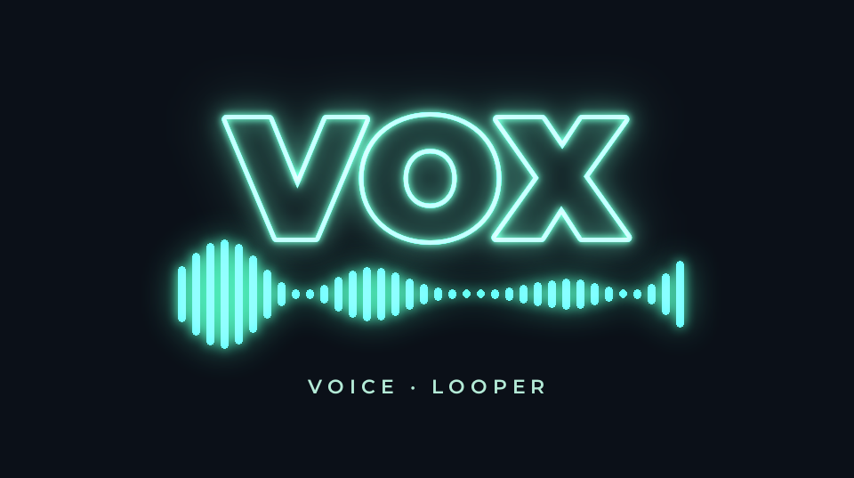

# VOX – voice processor and looper



A voice processor and a four-track looper for your vocals. Sing into it and it sounds like a record: a de-esser and a
good compressor, pitch correction from gentle to robot, a harmonizer, a vocoder, a doubler, delay and reverb – then
loop it, layer it, beatbox over it.

**Try it in the browser:** https://play.thefirmwarehub.com/?fw=vox – click *Audio input*, allow the microphone,
headphones on.

VOX is a native firmware for [VIBE FM](https://thefirmwarehub.com/platform/): the VIBE FM Mk1, the plugin (VST3 / CLAP /
AU, also as an effect on your vocal track: *VIBE FM VST FX*) and the browser run the same `.wasm`.

## Signal path

```
IN → gain → gate → compressor + de-esser → EQ → pitch engine (auto-tune, pitch, formant, harmonizer)
   → vocoder → colour → doubler → LOOPER (4 tracks) → delay → reverb → OUT
```

- **Input** – line, mic, Hi-Z or USB (the computer at the VIBE's USB cable). Gate with hold and hysteresis.
- **Compressor** – one knob, four kinds: VOICE (two stages: peaks, then levelling, program-dependent release), FET,
  OPTO, CLEAN. No lookahead, no latency.
- **De-esser** – split band with relative detection, S-frequency 4–10 kHz.
- **EQ** – low cut, low shelf, a bell, high shelf.
- **Tune** – key, scale (chromatic, major, minor, penta, blues, or the notes you hold on the keys), speed from
  hard to 400 ms, amount.
- **Pitch engine** – TD-PSOLA: pitch ±12 semitones, formant ±8, up to four voices for the harmonizer (third, fifth,
  triad, octave down, choir, or the keys), 14–19 ms latency.
- **Vocoder** – 8–24 bands, carrier saw / pulse / super / IN 2 or any MIDI keyboard; HOLD keeps the chord.
- **Colour** – radio, telephone, megaphone, robot, lo-fi. **Doubler**.
- **FX** – delay (synced 1/16 – 1/2), reverb, modulation, each with its kinds.
- **16 programs on the pads** – NATURAL, RADIO, PHONE, MEGAPHONE, ROBOT, CHOIR, MONSTER, CHIPMUNK, ALIEN,
  CATHEDRAL, ECHO WALL, LO-FI … tap = stays, hold = only while held. Save your own over them.

## Looper

Four tracks side by side, 24 s stereo each, the way a loop station works – one switch per track:
press = record → play → overdub → play, hold = undo/redo, twice = stop at the loop's end. The first loop sets the
length (free or bars to the tempo), the others wait for its start and end on a multiple, all in phase. Per track a
volume fader and two sends (delay, reverb); REC FX records the voice with its effects. **SAVE WAV** writes a track as a
32-bit float WAV (`VIBE FM/vox/`). On the VIBE the pads 1–4 / 5–8 and the encoder pushes play the tracks.

## Controls

K1–K6 = INPUT · EQ · VOX · PITCH · FX · LOOP – the same key again is the next sub-page (chips in the header).
Encoders 1–4 = the page's values. F1 MIXER (dry/wet) · F2 PRESETS · F3/F4 program −/+ · F5 SAVE · F6 GLOBAL.
In the plugin and the browser the mouse works in the display. `cheatsheet.html` lists every key, `KONZEPT.md` is the
design notebook (German).

## Build

Built with the VIBE FM SDK. Put this repository at `firmware/vox/` in the SDK, then:

```
tools/build.sh vox                       # build/vox.wasm (+ vox.vibe.aot for the device)
node tools/vibe-check.mjs build/vox.wasm
tools/deploy-device.sh vox               # onto a VIBE
```

Files: `dsp.c` input stage, gate, compressor, de-esser, EQ, pitch tracker, vocoder, FX · `voice.c` the pitch engine
(PSOLA) · `loop.c` the looper · `prog.c` the 16 programs and global settings · `main.c` events, pages, audio chain ·
`ui.c` the display.

## License

GPL-3.0-or-later – see `LICENSE`. Copyright 2026 Sven Trogus (zvenson). The name VOX and the logo are not part of the
license.
